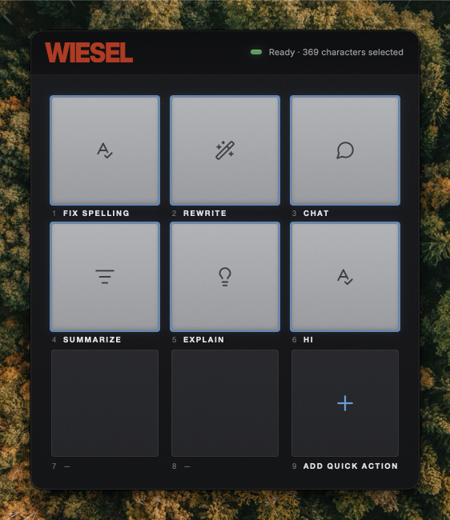

<p align="center">
  
</p>

<h1 align="center">Wiesel</h1>

<p align="center">
  <strong>Select text anywhere. Press a shortcut. Let AI do the rest.</strong><br>
  A tiny, fast, native writing sidekick for macOS.
</p>

<p align="center">
  <a href="https://github.com/zeekrey/wiesel/releases/latest"><strong>Download for macOS</strong></a> ·
  <a href="https://wiesel.run">wiesel.run</a>
</p>

---

## Why Wiesel?

You're writing an email, a doc or a Slack message, and the sentence just isn't right. Instead of copy-pasting into a chat window, you highlight it, press **⌘⇧Space**, then hit **1**. Done.

- ✍️ **Fix spelling, rewrite, summarize, explain** with one keystroke
- 💬 **Chat** about anything you selected
- 🧩 **Your own quick actions**: up to nine pads, each with its own prompt, icon and model
- 📋 **Paste result back**: let an action replace your selection directly, no extra clicks
- 🏠 **Runs locally if you want**: use [Ollama](https://ollama.com) on your Mac, or sign in to Wiesel for cloud models
- 🪶 **Native and lightweight**: no Electron, follows Light/Dark mode, stays out of your way

## Install

1. Download the latest **`.dmg`** from [Releases](https://github.com/zeekrey/wiesel/releases/latest)
   - Apple Silicon (M1 and later): `macos-arm64`
   - Intel Mac: `macos-x86_64`
2. Open it and drag **Wiesel** into **Applications**.
3. Launch Wiesel.

> [!NOTE]
> Wiesel isn't notarized by Apple yet, so macOS may refuse to open it the first time.
> Go to **System Settings → Privacy & Security**, scroll down and click **Open Anyway**.

## Set it up (two minutes, promise)

**1. Pick your shortcut.** The default is **⌘⇧Space**. Press a new combo to record your own.

**2. Allow Accessibility.** Wiesel needs this to copy your selected text.
Open **System Settings → Privacy & Security → Accessibility** and switch on **Wiesel**.
Wiesel notices right away, no restart needed.

**3. Choose where the AI lives.** In **Settings**, pick a provider tab:

| | **Wiesel** (cloud) | **Ollama** (local) |
|---|---|---|
| Setup | Click **Login / Sign up** and finish in your browser | Install [Ollama](https://ollama.com) and pull a model, e.g. `ollama pull llama3` |
| Account | An account at [wiesel.run](https://wiesel.run) | None |
| Your text goes to | Wiesel and its model provider | Nowhere. It stays on your Mac |

**4. Assign your models.** Wiesel has three speed tiers, and you can pick any model for each:

- ⚡ **Swift**: fast and clever, for quick fixes and short replies
- 🎯 **Sharp**: balanced, used by default
- 🧠 **Sage**: slow and super smart, for the hard problems

That's it. Go select some text. 🎉

## Use it

| Do this | To get this |
|---|---|
| Select text, press **⌘⇧Space** | Wiesel opens with your text ready |
| **1** – **9** | Run the matching quick action |
| **⌘N** | New chat |
| **⌘,** | Settings |
| **Esc** | Go back, or hide Wiesel |
| **⌘Q** | Quit |

Results show up in Wiesel so you can review and **Copy** them. Turn on **Paste result back** for an action and Wiesel pastes over your selection instead.

### Make your own quick actions

Click the **+** pad (or **File → New Quick Action…**), give it a name and an icon, and write instructions. Two placeholders make it useful:

- `{selection}`: the text you selected
- `{clipboard}`: whatever's on your clipboard

```text
Translate the following into friendly, casual German:

{selection}
```

Each action can use a tier (Swift, Sharp, Sage) or a specific model. Edit or remove actions anytime with **Wiesel → Adjust Quick Actions…**. The built-in ones too.

## Privacy

- Wiesel only sends text **when you run an action or hit Send**.
- With **Ollama**, nothing leaves your Mac.
- Chats and results live in memory only. Nothing is saved to disk.
- Your clipboard is restored after Wiesel grabs your selection.
- Login tokens are stored in the macOS Keychain.

## FAQ

<details>
<summary><strong>Wiesel says it needs Accessibility, but I already allowed it.</strong></summary>

Remove Wiesel from the Accessibility list with the **–** button, add it again with **+**, then relaunch Wiesel. This usually happens after an update.
</details>

<details>
<summary><strong>Nothing happens when I press the shortcut.</strong></summary>

Another app might already use that combo. Pick a different one in **Settings**.
</details>

<details>
<summary><strong>It doesn't work in a certain app.</strong></summary>

Wiesel grabs your selection by copying it. Apps that block copying (and password fields) can't be read. Paste the text into **Chat** instead.
</details>

<details>
<summary><strong>Ollama shows "not running".</strong></summary>

Open the Ollama app, or run `ollama serve`, then click **Check** in Settings.
</details>

<details>
<summary><strong>Does it work on Windows or Linux?</strong></summary>

Not yet. Wiesel is macOS-only for now.
</details>

---

<p align="center">
  Made with ☕ and Rust. Want to hack on Wiesel? See <a href="CONTRIBUTING.md">CONTRIBUTING.md</a>.
</p>
